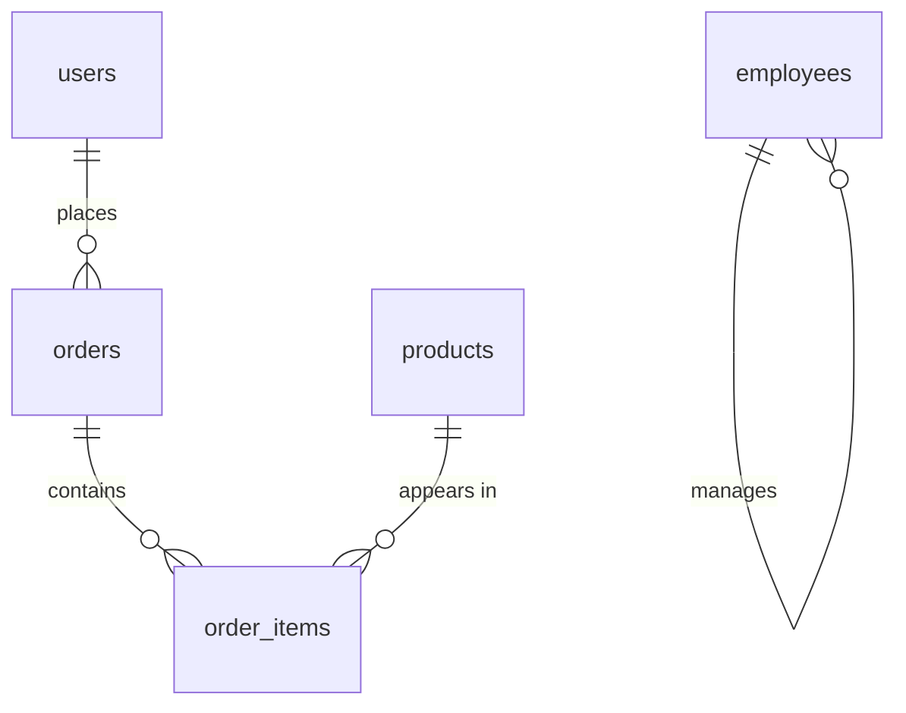

Most engineers learn SQL the same way: enough `SELECT` to unblock a feature, then years of copying query shapes they only half understand.

That works until a join silently duplicates rows, a window function returns the wrong "latest record", a `NOT IN` query returns nothing, or a report that took 40 ms in staging takes 40 seconds in production.

This track fixes the fundamentals properly. Every chapter explains **what the feature is for**, **how it behaves** (including the edge cases), and **when to reach for it** — in PostgreSQL, with notes where MySQL/SQL Server differ.

## How to read this track

| # | Chapter | What it answers |
|---|---|---|
| 1 | [How SQL Actually Runs](/databases/sql/001-sql-execution-model) | Why `WHERE` cannot see a `SELECT` alias, what `NULL` really means |
| 2 | [Joins in Depth](/databases/sql/002-joins-in-depth) | Inner/left/right/full/cross/self joins, anti-joins, fan-out |
| 3 | [Set Operations & Subqueries](/databases/sql/003-set-operations-and-subqueries) | `UNION` vs `UNION ALL`, `IN` vs `EXISTS`, `LATERAL` |
| 4 | [Aggregation & Grouping](/databases/sql/004-aggregation-and-grouping) | `COUNT` traps, `HAVING`, `FILTER`, `ROLLUP`, top-N per group |
| 5 | [Window Functions](/databases/sql/005-window-functions) | `OVER`, frames, ranking, running totals, de-duplication |
| 6 | [Functions & Expressions](/databases/sql/006-sql-functions-and-expressions) | String/date/number helpers, `CASE`, casts, JSONB |
| 7 | [CTEs & Recursion](/databases/sql/007-ctes-and-recursive-queries) | Readable pipelines and recursive hierarchies |
| 8 | [DML, DDL & Constraints](/databases/sql/008-dml-ddl-and-constraints) | Upserts, `MERGE`, safe `UPDATE`/`DELETE`, schema changes |
| 9 | [Transactions & Isolation](/databases/sql/009-transactions-and-isolation) | Anomalies, isolation levels, locking, deadlocks |
| 10 | [Indexes & Query Plans](/databases/sql/010-indexes-and-query-plans) | B-trees, composite indexes, reading `EXPLAIN ANALYZE` |
| 11 | [Schema Design in Practice](/databases/sql/011-schema-design-and-modeling) | Keys, types, normalization, deliberate denormalization |
| 12 | [Anti-Patterns & Readiness Checklist](/databases/sql/012-sql-anti-patterns-and-checklist) | The mistakes that show up in code review |

If you already know the basics, chapter 2 (joins) and chapter 5 (windows) give the highest return per minute — they cause the majority of production data bugs.

## Run everything yourself

Blocks marked **runnable** have a **Run** button: they execute against a real PostgreSQL 17 database compiled to WebAssembly inside your browser tab. Nothing is sent to a server.

```sql run
SELECT status, COUNT(*) AS orders, SUM(total_cents) / 100.0 AS revenue
FROM orders
GROUP BY status
ORDER BY revenue DESC;
```

## Practice with instant feedback

The [SQL Playground](/playground) is a practice sheet: 64 exercises on the classic **Northwind** dataset, grouped by topic (filtering → joins → aggregation → subqueries → windows → CTEs → set operations → functions). Write a query, press **Check answer**, and your result is compared row-for-row with the reference answer. The schema reference sits beside the editor.

- **[Open the practice sheet](/playground)** — progress is stored in your browser.
- Every question has a hint, a schema reference, and a reference answer.
- The questions are adapted from the MIT-licensed [SQL-Northwind-exercises](https://github.com/eirkostop/SQL-Northwind-exercises) sheet; the dataset is the [Northwind Postgres port](https://github.com/pthom/northwind_psql).

## The sample schema

Every chapter uses the same five tables, so examples compose. Keep this picture in mind:



```sql
users(id, email, full_name, country, created_at)
products(id, name, category, price_cents, in_stock)
orders(id, user_id → users.id, status, placed_at, total_cents)
order_items(id, order_id → orders.id, product_id → products.id, quantity, unit_price_cents)
employees(id, full_name, department, manager_id → employees.id, salary_cents, hired_at)
```

Money is stored as integer cents (`total_cents`), timestamps are `timestamptz`, and statuses are constrained by a `CHECK`. Those choices are explained in chapter 11 — they are not accidental.

> [!NOTE]
> **Dialect policy**
> Examples target PostgreSQL 13+ (a few use 15/16 features, flagged inline). MySQL and SQL Server diverge mainly on window/CTE support (fine in modern versions), `RETURNING` (Postgres only; `OUTPUT` in SQL Server), upserts (`ON CONFLICT` vs `ON DUPLICATE KEY` vs `MERGE`), and date functions. The mental models in chapters 1–5 are portable.
