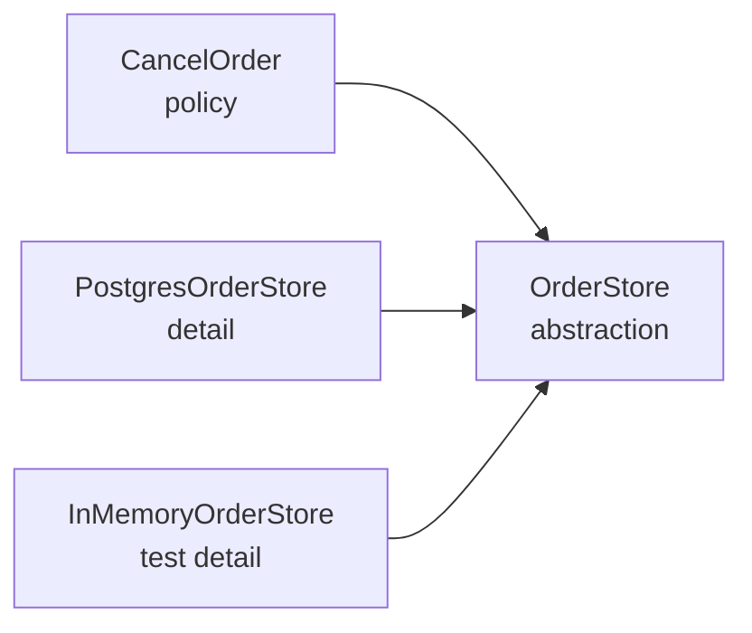

DIP has two parts, and most explanations stop after the first:

1. **High-level policy should not depend on low-level details. Both should depend on abstractions.**
2. **Abstractions should not depend on details. Details should depend on abstractions.**

The second part is the important one in practice: **the business rule owns the interface**, and the database/web framework/adapter implements it. The arrow of *source code* dependency points inward, toward the policy.

## The problem

```ts
import { Client } from "pg";

export class CancelOrder {
  async execute(orderId: string): Promise<void> {
    const client = new Client({ connectionString: process.env.DATABASE_URL });
    await client.connect();

    const result = await client.query(
      "SELECT status FROM orders WHERE id = $1 FOR UPDATE",
      [orderId],
    );
    if (result.rows[0]?.status !== "placed") {
      throw new Error("only placed orders can be cancelled");
    }

    await client.query("UPDATE orders SET status = 'cancelled' WHERE id = $1", [orderId]);
    await client.end();
  }
}
```

The **business rule** ("only placed orders can be cancelled") is tangled with:

- connection configuration,
- SQL dialect,
- transaction and locking semantics,
- lifecycle (`connect`/`end`),
- test infrastructure.

A change to the ORM or connection pool reopens the use case. A unit test needs Postgres.

## Inverting it

The policy declares what it needs:

```ts
export interface OrderStore {
  findForUpdate(id: OrderId): Promise<Order | null>;
  save(order: Order): Promise<void>;
}

export class CancelOrder {
  constructor(private readonly orders: OrderStore) {}

  async execute(orderId: OrderId): Promise<void> {
    const order = await this.orders.findForUpdate(orderId);
    if (!order) throw new OrderNotFound(orderId);
    order.cancel();                 // domain rule lives here
    await this.orders.save(order);
  }
}
```

The adapter depends on the policy's interface:

```ts
import { Pool } from "pg";

export class PostgresOrderStore implements OrderStore {
  constructor(private readonly pool: Pool) {}

  async findForUpdate(id: OrderId): Promise<Order | null> {
    const { rows } = await this.pool.query(
      "SELECT * FROM orders WHERE id = $1 FOR UPDATE",
      [id],
    );
    return rows[0] ? mapRowToOrder(rows[0]) : null;
  }

  async save(order: Order): Promise<void> {
    await this.pool.query(
      "UPDATE orders SET status = $2 WHERE id = $1",
      [order.id, order.status],
    );
  }
}
```

Dependency arrows:



`CancelOrder` does not import `pg`. `PostgresOrderStore` imports the abstraction (or its package) and implements it. The **policy owns the contract**, which is why this is *inversion* rather than mere injection.

## Where should the interface live?

In the module that **uses** it (the policy), not next to the database code.

- `domain/orders/ports.ts` → `OrderStore`, `Clock`, `PaymentGateway`
- `adapters/postgres/PostgresOrderStore.ts` → implements the port
- `app/composition.ts` → wires concrete adapters into use cases

If the interface lives in the adapter package, the domain still depends on the adapter's package to import it — the arrow has not inverted.

## Dependency injection vs. DIP

These are related but not the same:

| Concept | What it is | What it does **not** guarantee |
|---|---|---|
| **Dependency injection** | passing collaborators in instead of constructing them | that the dependency is an abstraction |
| **DIP** | the policy owns abstractions; details implement them | that a container is used |
| **DI container** | a framework for wiring object graphs | good design; can hide dependencies |
| **Service locator** | objects pull dependencies from a global registry | explicit dependencies; testability |

You can do DIP with plain constructor parameters:

```ts
const cancelOrder = new CancelOrder(new PostgresOrderStore(pool));
```

A container is useful when the graph is large; it is not the principle.

> [!WARNING]
> Service locators (`container.resolve(OrderStore)`) hide dependencies: a class's signature no longer tells you what it needs, and tests must configure global state. Prefer explicit constructor injection; keep the container at the composition root.

## Testing the policy

```ts
class InMemoryOrderStore implements OrderStore {
  constructor(private readonly orders = new Map<string, Order>()) {}

  async findForUpdate(id: OrderId): Promise<Order | null> {
    return this.orders.get(id) ?? null;
  }

  async save(order: Order): Promise<void> {
    this.orders.set(order.id, order);
  }
}

test("does not cancel a shipped order", async () => {
  const orders = new InMemoryOrderStore();
  orders.save(Order.shipped("o1"));
  const useCase = new CancelOrder(orders);

  await expect(useCase.execute("o1")).rejects.toBeInstanceOf(OrderNotCancellable);
});
```

No database, no network, no sleep. The rule is tested directly.

Test the adapter separately, with a real Postgres in a container — for locking and SQL correctness, which the fake cannot prove.

## The composition root

Wiring belongs in **one place**, at the edge of the application:

```ts
// app.ts
const pool = new Pool({ connectionString: env.DATABASE_URL });

const cancelOrder = new CancelOrder(new PostgresOrderStore(pool));
const http = new HttpServer({ cancelOrder });

http.listen(8080);
```

Only this file knows about `pg`, environment variables, and the HTTP framework. Everything inside is testable and replaceable.

## Clean/hexagonal architecture in one sentence

The domain in the middle; use cases around it; adapters at the edge. Dependencies point inward. The database, the web framework, and third-party APIs are **details** that the domain describes through ports.

You do not need the full ceremony to benefit: **one port per external effect** (storage, payments, email, clock, filesystem) is enough for most services.

## Pitfalls

- **Leaky abstractions.** If `OrderStore` exposes `query(sql)`, it is a database, not a port. The abstraction must speak the domain's language (`findForUpdate`), not the driver's.
- **Over-abstraction.** A `UserFormatter` interface with one trivial implementation adds a hop for nothing. Invert where there is an external effect, a real second implementation, or a test seam you need.
- **Dependency on a vendor type.** `charge(card: StripeCard)` leaks the vendor into the policy. Map to your own types at the boundary.
- **Circular dependencies.** Two modules importing each other's interfaces usually means the boundary is wrong (or the entities belong together).
- **Container magic.** Constructor injection is explicit; property injection and decorators hide requirements from the type system.

## Exercises

1. Find a use case that imports a database driver, HTTP client, or framework. Extract one port and inject it.
2. Write an in-memory adapter for that port and a unit test for the business rule.
3. Draw the source-dependency graph of one service. Mark every arrow pointing at a framework.
4. Refactor a service-locator call (`container.resolve(...)`) into constructor injection.
5. Decide which abstractions to delete: those with one implementation, no external effect, and no test seam.

## Checklist

- [ ] Business rules import no framework, driver, or transport code.
- [ ] Ports are defined by the policy and speak domain types.
- [ ] Adapters implement ports and are wired only at the composition root.
- [ ] Tests for rules run with in-memory fakes; adapters have their own integration tests.
- [ ] Dependencies flow inward; no vendor type crosses the boundary.
- [ ] Abstractions exist for external effects, real variants, or test seams — not for ceremony.

Next: [Introduction to Design Patterns](/lld/007-design-patterns-intro) — the vocabulary built on top of these principles.
