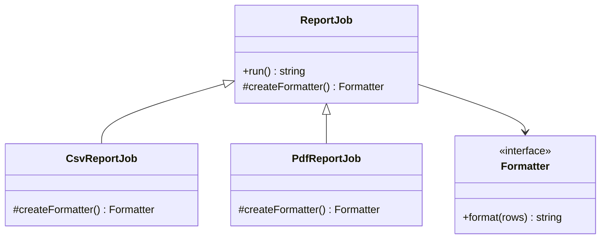

Factories exist because **object creation is often a decision, not a constructor call**: which implementation, which configuration, which lifecycle, which validation.

The pattern is not "a class named `Factory`". It is a boundary that turns a runtime input (config, MIME type, feature flag, tenant) into a ready-to-use object, with the construction rules in one place.

## The problem

```ts
async function sendWelcome(user: User): Promise<void> {
  let sender;
  if (process.env.EMAIL_PROVIDER === "ses") {
    sender = new SesEmailSender(
      new AWS.SES({ region: process.env.AWS_REGION }),
      process.env.SES_TEMPLATE_ID!,
    );
  } else if (process.env.EMAIL_PROVIDER === "postmark") {
    sender = new PostmarkSender(process.env.POSTMARK_TOKEN!);
  } else {
    sender = new SmtpSender(process.env.SMTP_URL!);
  }

  await sender.send(user.email, "Welcome");
}
```

Construction is duplicated in every caller, reads environment variables deep inside business code, and cannot be tested without manipulating the environment.

## Three shapes, three purposes

| Shape | What it does | Use when |
|---|---|---|
| **Simple factory** (function) | maps an input to a created object | one decision, no subclassing |
| **Factory Method** | a base class defines the creation hook; subclasses choose the product | behaviour varies with the product family, inheritance is already in play |
| **Abstract Factory** | creates a **family** of related objects | the products must be consistent (e.g., UI widgets per theme) |

Start with the function. Most production "Factory Method" needs are a map and a `switch` in one place.

## Simple factory

```ts
export interface EmailSender {
  send(to: string, subject: string, body: string): Promise<void>;
}

export function createEmailSender(config: EmailConfig): EmailSender {
  switch (config.provider) {
    case "ses":
      return new SesEmailSender(makeSesClient(config), config.templateId);
    case "postmark":
      return new PostmarkSender(config.token);
    case "smtp":
      return new SmtpSender(config.url);
    default:
      throw new UnknownEmailProvider(config.provider satisfies never);
  }
}
```

Callers now depend on the **interface** and on the factory, not on three vendor SDKs:

```ts
class WelcomeFlow {
  constructor(private readonly emails: EmailSender) {}

  async run(user: User): Promise<void> {
    await this.emails.send(user.email, "Welcome", renderWelcome(user));
  }
}
```

The `satisfies never` trick gives a compile-time error if a new config variant is added without a case.

### Registry variant

When plugins are registered at startup:

```ts
type SenderFactory = (config: EmailConfig) => EmailSender;

const factories = new Map<string, SenderFactory>();

export function registerEmailProvider(key: string, factory: SenderFactory): void {
  if (factories.has(key)) throw new Error(`duplicate provider: ${key}`);
  factories.set(key, factory);
}

export function createEmailSender(config: EmailConfig): EmailSender {
  const factory = factories.get(config.provider);
  if (!factory) throw new UnknownEmailProvider(config.provider);
  return factory(config);
}
```

The registry is [Open/Closed](/lld/003-open-closed), but it is global state: reset it between tests or inject it (see below).

## Factory Method

When a base algorithm needs a product chosen by the subclass:



```ts
abstract class ReportJob {
  async run(): Promise<string> {
    const rows = await this.loadRows();
    return this.createFormatter().format(rows);
  }

  protected abstract createFormatter(): Formatter;
  protected abstract loadRows(): Promise<Row[]>;
}

class CsvReportJob extends ReportJob {
  protected createFormatter(): Formatter { return new CsvFormatter(); }
  protected loadRows(): Promise<Row[]> { /* ... */ }
}
```

This is useful when the **algorithm is fixed** and the product varies. It is a poor fit when both vary — that is what composition is for.

## Abstract Factory

For consistent families:

```ts
interface UiFactory {
  button(): Button;
  input(): Input;
  modal(): Modal;
}

class DarkUiFactory implements UiFactory { /* ... */ }
class LightUiFactory implements UiFactory { /* ... */ }

function renderSettings(factory: UiFactory): View {
  return view([factory.button("Save"), factory.input("Name"), factory.modal("Confirm")]);
}
```

The guarantee is *consistency*, not just creation: every widget comes from the same theme. If products do not need to match, you do not need an abstract factory.

## Factories and dependency injection

A factory often **is** the composition root for a subtree:

```ts
const emailSender = createEmailSender(config.email);
const welcome = new WelcomeFlow(emailSender);
```

You can also inject the factory itself when the object must be created per request:

```ts
class ReportController {
  constructor(private readonly reports: ReportFactory) {}

  async generate(kind: string): Promise<string> {
    return this.reports.create(kind).run();
  }
}
```

Prefer injecting the **factory as a function** (`type ReportFactory = (kind: string) => ReportJob`) to injecting a class with one method.

## Trade-offs

**Gains**

- construction rules live in one place;
- callers depend on interfaces, not vendor SDKs;
- config/env access is confined to the edge;
- tests can substitute fakes without touching business code.

**Costs**

- another hop between the caller and the real object;
- hidden failures at creation time (bad config) unless validated early;
- registries become global mutable state;
- class-heavy versions obscure a simple `if`/`map`.

**Do not** introduce a factory when:

- construction is a plain `new` with constants;
- there is exactly one implementation and no config decision;
- the only "variation" is a boolean you can pass as an argument.

> [!WARNING]
> Validate configuration when the factory is called, at startup if possible. A factory that throws on the first request is worse than a failing fast boot.

## Testing

- **Factory tests**: each provider key returns the expected type; unknown key fails with a typed error; missing config fails fast.
- **Consumer tests**: inject a fake `EmailSender`; no environment variables involved.
- **Registry tests**: reset the registry in `beforeEach`, assert duplicate registration fails.

```ts
test("rejects unknown provider", () => {
  expect(() => createEmailSender({ provider: "carrier-pigeon" } as never))
    .toThrow(UnknownEmailProvider);
});
```

## Exercises

1. Replace an env-var `if/else` construction chain with a `createX(config)` factory.
2. Add a provider to the registry without editing existing providers; count the files changed.
3. Design a `ReportJob` Factory Method for CSV/PDF, then refactor it to composition and compare.
4. Identify a factory in your codebase that only wraps `new` with constants. Delete it.

## Checklist

- [ ] Construction decisions live in one module, not in callers.
- [ ] Factories return interfaces/ports, not vendor types.
- [ ] Configuration is validated early and errors are typed.
- [ ] The simplest shape is used (function before class hierarchy).
- [ ] Registries are injectable or reset in tests.
- [ ] There is a real variant or configuration decision justifying the indirection.

Next: [Singleton](/lld/009-singleton-pattern) — the pattern most often used to hide a dependency.
