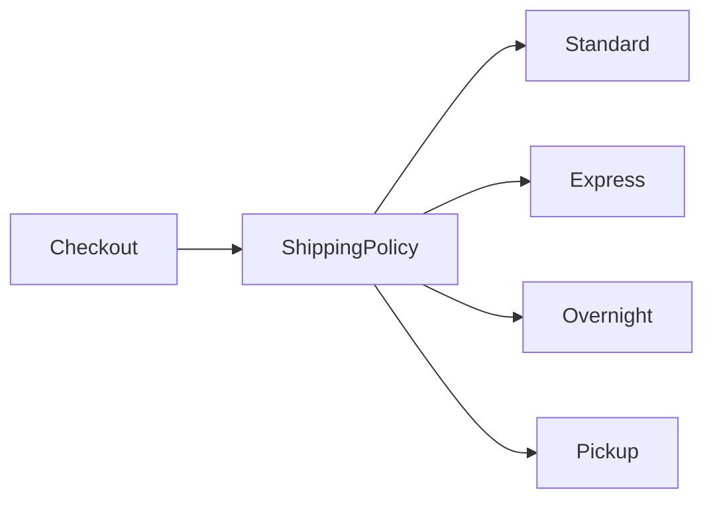

Strategy is the answer to a specific smell: **one algorithm with several variants, selected at runtime, where every new variant edits the same function.**

It is not "an interface with two implementations". It is a way to make the *choice* explicit and keep each policy independently testable.

## The problem

```ts
function shippingCost(order: Order, method: string): Money {
  switch (method) {
    case "standard":
      return order.weightKg <= 5 ? usd(5) : usd(5 + (order.weightKg - 5) * 0.5);
    case "express":
      return usd(15 + order.weightKg * 1.2);
    case "overnight":
      return usd(30 + order.weightKg * 2) + (order.saturday ? usd(20) : usd(0));
    case "pickup":
      return usd(0);
    default:
      throw new Error(`unknown shipping method: ${method}`);
  }
}
```

This function is edited by operations (prices), logistics (zones), and marketing (free shipping). It mixes selection with policy. Testing one method requires constructing orders for all branches.

## Structure



The **context** (`Checkout`) depends on the abstraction. The **strategies** implement one policy each. **Selection** happens at the edge (config, request, feature flag), not inside the algorithm.

## Function-based strategy (start here)

In TypeScript a strategy is often just a function:

```ts
export type ShippingPolicy = (order: Order) => Money;

export const standardShipping: ShippingPolicy = (order) =>
  order.weightKg <= 5
    ? usd(5)
    : usd(5 + (order.weightKg - 5) * 0.5);

export const expressShipping: ShippingPolicy = (order) =>
  usd(15 + order.weightKg * 1.2);

export const overnightShipping: ShippingPolicy = (order) =>
  usd(30 + order.weightKg * 2).plus(order.saturday ? usd(20) : usd(0));

export const pickup: ShippingPolicy = () => usd(0);
```

Dispatch in one place:

```ts
const SHIPPING: Record<string, ShippingPolicy> = {
  standard: standardShipping,
  express: expressShipping,
  overnight: overnightShipping,
  pickup,
};

export function shippingPolicyFor(method: string): ShippingPolicy {
  const policy = SHIPPING[method];
  if (!policy) throw new UnknownShippingMethod(method);
  return policy;
}
```

Callers:

```ts
class Checkout {
  constructor(private readonly shipping: ShippingPolicy) {}

  total(order: Order): Money {
    return sum(order.lines).plus(this.shipping(order));
  }
}
```

No classes, no `this`, no ceremony. Each policy is a pure function: trivial to test, compose, and memoize.

## Class-based strategy

Use a class when the policy has **configuration or collaborators**:

```ts
interface DiscountStrategy {
  apply(amount: Money, cart: Cart): Money;
}

class PercentageDiscount implements DiscountStrategy {
  constructor(private readonly percent: number) {}
  apply(amount: Money): Money {
    return amount.times(1 - this.percent / 100);
  }
}

class CouponDiscount implements DiscountStrategy {
  constructor(private readonly coupons: CouponReader) {}
  async apply(amount: Money, cart: Cart): Promise<Money> {
    const coupon = await this.coupons.find(cart.couponCode);
    return coupon ? amount.minus(coupon.value) : amount;
  }
}
```

If `apply` becomes async, note that the **interface** changes for everyone. Function strategies have the same issue; choose sync where possible.

## Selection belongs at the edge

A common mistake is injecting a "strategy selector" into the domain:

```ts
// Avoid: the domain now knows about plans and config.
class Checkout {
  constructor(private readonly config: Config) {}
  total(order: Order) {
    return order.total.plus(pickShipping(this.config.shippingMethod)(order));
  }
}
```

Prefer resolving the strategy at the composition root or controller:

```ts
const policy = shippingPolicyFor(request.body.shippingMethod);
const checkout = new Checkout(policy);
```

The domain receives the decision, not the decision-making machinery.

## Composition over a strategy per combination

Discounts combine independently of shipping methods. Do not create `ExpressWithBlackFridayPolicy`:

```ts
type PriceRule = (amount: Money, cart: Cart) => Money;

const blackFriday: PriceRule = (amount) => amount.times(0.7);
const loyalty: PriceRule = (amount, cart) =>
  cart.customer.loyal ? amount.times(0.95) : amount;

function applyRules(amount: Money, cart: Cart, rules: PriceRule[]): Money {
  return rules.reduce((current, rule) => rule(current, cart), amount);
}

const price = applyRules(subtotal, cart, [blackFriday, loyalty]);
```

Ordering becomes an explicit, testable decision — which matters for money.

## Strategy vs. other patterns

| Need | Better fit |
|---|---|
| Choose one algorithm at runtime | Strategy |
| Create the strategy from config/type | [Factory](/lld/008-factory-pattern) |
| React to events, not replace an algorithm | [Observer](/lld/011-observer-pattern) |
| Wrap a call with retry/cache/auth | Decorator |
| Behaviour changes with internal state over time | State |

Strategy is about **replacement**; State is about **transitions driven by the object**, Observer is about **notification**.

## Trade-offs

**Gains**

- one policy per file, independently testable;
- dispatch is explicit and exhaustively checkable;
- adding a variant does not reopen existing policies;
- policies can be composed (rules) or injected (tests).

**Costs**

- the caller must know how to select (or a factory must);
- indirection when there is only one strategy;
- stateful strategies become hidden shared state — keep them stateless or scope them per request;
- too many tiny strategies can fragment a coherent rule.

**Do not** introduce Strategy for:

- two branches that will never grow;
- selection based on a single boolean that can be a parameter;
- algorithms that differ only in a constant (`fee = 5` vs `fee = 10`).

## Testing

```ts
test("overnight adds Saturday surcharge", () => {
  const order = orderWith({ weightKg: 2, saturday: true });
  expect(overnightShipping(order)).toEqual(usd(30 + 2 * 2 + 20));
});

test("unknown method is a typed error", () => {
  expect(() => shippingPolicyFor("teleport")).toThrow(UnknownShippingMethod);
});
```

If strategies share a contract (idempotency, monotonicity, never negative), write a **contract suite** and run it for each. That catches a policy that returns a negative total only under a rare combination.

## Exercises

1. Replace a `switch` on a domain type with a map of functions. Add a new variant and count edited files.
2. Decide which discounts should compose vs. which are mutually exclusive; model both.
3. Move strategy selection from a service into the composition root.
4. Write a contract test that every `ShippingPolicy` returns non-negative money and zero for an empty order.

## Checklist

- [ ] Each strategy implements exactly one policy.
- [ ] Selection is explicit and central (map, factory, or injected decision).
- [ ] Strategies are stateless or request-scoped.
- [ ] The common path does not require reading five files.
- [ ] Adding a variant touches one new file plus one registration.
- [ ] A contract test runs against every strategy.
- [ ] A simple parameter or function was ruled out first.

Next: [Observer](/lld/011-observer-pattern) — decoupling notification without creating a memory leak.
